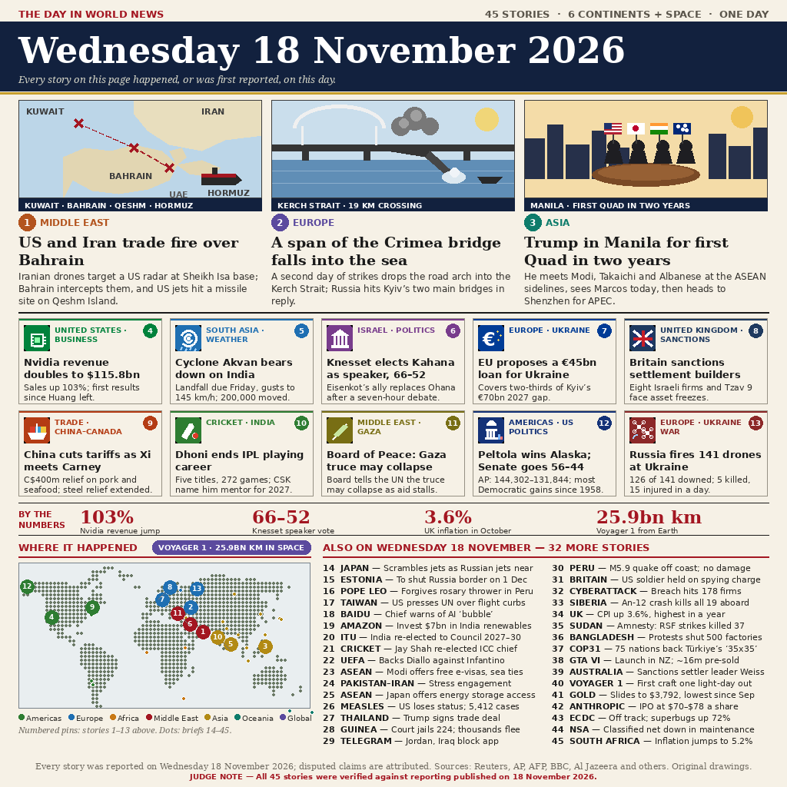

# news-image-20261118

[](https://make.fun/bounty/news-image-20261118?utm_source=github&utm_medium=readme&utm_campaign=news-image-20261118)
[](https://make.fun/bounty/news-image-20261118/leaderboard?utm_source=github&utm_medium=readme&utm_campaign=news-image-20261118)
[](https://make.fun/bounty/news-image-20261118?utm_source=github&utm_medium=readme&utm_campaign=news-image-20261118)

**The world's news for Wednesday 18 November 2026, in one image** — a
front-page poster summing up the day: Trump in Manila for the first Quad in
two years, US and Iranian forces trading fire over Bahrain, Ukraine
collapsing a span of the Crimea bridge, Nvidia's 103% revenue jump, Cyclone
Akvan bearing down on India's east coast, Democrat Peltola winning Alaska
to put the Senate at 56–44, Russia firing 141 drones at Ukraine, and 38
more stories from six continents and space, with a map of where it all
happened. 45 stories in total, every one checked against live reporting
(Reuters, AP, AFP, BBC, Al Jazeera and others).

Referral code: `6etrfz79`

## The image



## How it was made

The poster was composed as a single 1024×1024 front page: three
hand-drawn illustrated leads (a schematic Gulf map, the collapsing Crimea
bridge, the Manila summit table) with ten more stories told in ten
illustrated cards, a numbered list of 32 further stories, a dotted world
map with the 13 main stories pinned and the rest dotted by region, and a
by-the-numbers strip. All art is drawn in code — no photographs. All text
on the poster is drawn as crisp vector type — no AI-generated lettering, so
nothing is garbled or misspelled.

## Run it

```sh
mkdir -p out && MAKEFUN_OUTPUT_DIR=out python3 main.py
```

`main.py` (Python 3.13, standard library only) copies `entry.png` to
`/output/entry.png`. No network access, and both runs write the same bytes.

## License

MIT — see [LICENSE](LICENSE).
